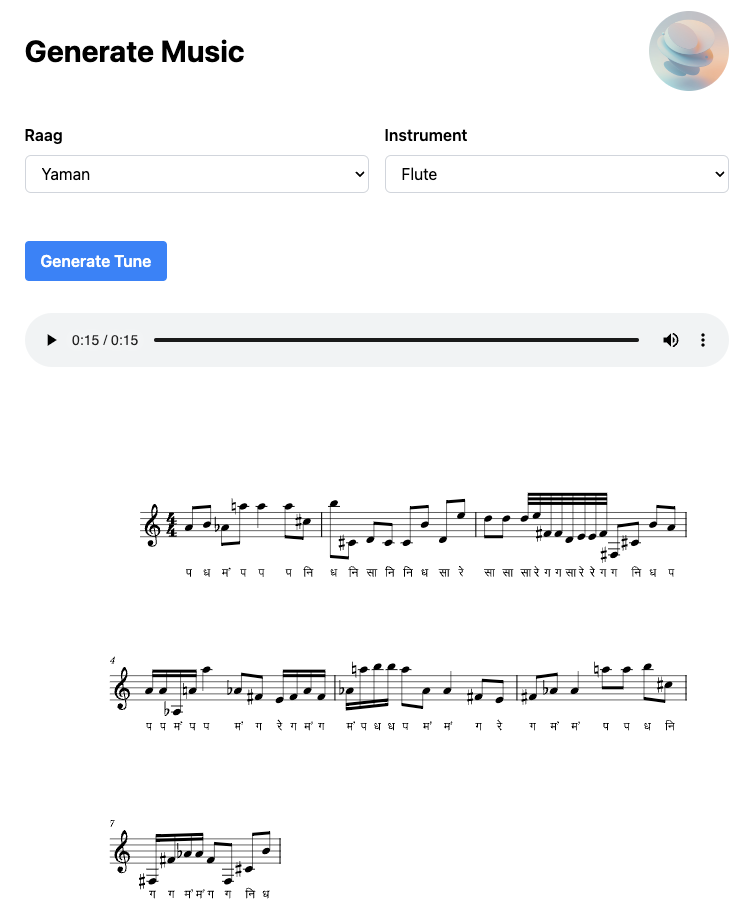

Demo :

https://raag.shamit-cloud.com/ui/ 

**Run an Instance**
1. Clone the repository
2. `docker build . --tag raag_gen:latest`
3. `docker run -d -p 9060:9060 --restart=unless-stopped --name raag raag_gen:latest`

**Local installation for development**:

1. Create a Python virtual environment (>= 3.10)
2. Install dependencies [requirements.txt](setup%2Frequirements.txt)
3. Start server [run_server.sh](run_server.sh)
4. Open UI in browser http://localhost:9060/ui

**Documentation**

- [Music generation overview](docs/music-generation/overview.md)
	- Outlines the full request flow from the UI button press through `BaseRaag.getTune` and musictree serialization.
	- Explains how raag logic and technical helpers (ChordGen, Instrument, musicxml, webmscore) collaborate during generation.
	- Includes a Mermaid diagram, note/instrument reference tables, and extension guidance for new raags/instruments.
	- Lists validation checkpoints so future updates keep the docs accurate.
- [Melodic logic details](docs/music-generation/TuneGenerationLogic.md)
	- Deep-dives into the Hindustani theory encoded in `BaseRaag` subclasses, including vadi/samvadi and Aroha/Avaroha handling.
	- Describes the weighted random walk, rhythmic grouping strategy, and current stylistic limitations (missing chalan/pakad/meend).
	- Highlights gaps between theoretical correctness and musical authenticity, calling out where the algorithm flattens expression.
	- Proposes concrete improvements such as phrase libraries, hybrid generation, and emphasis rules for signature notes.

