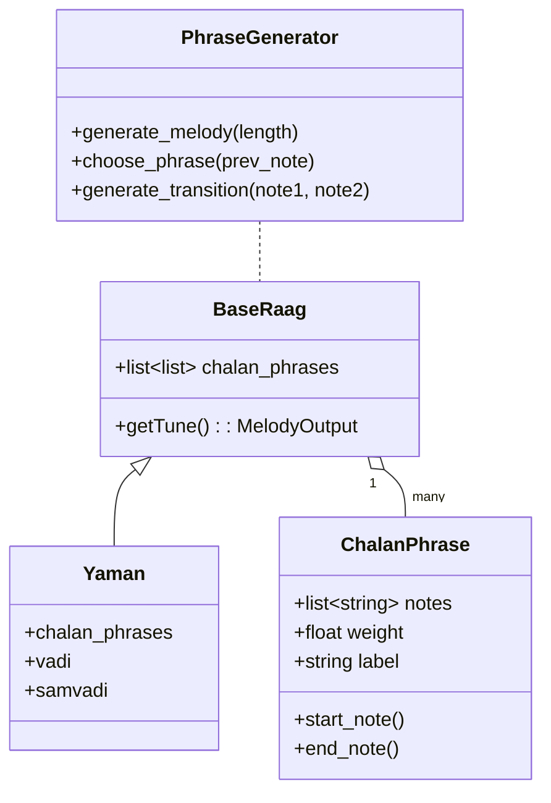

# Chalan-Based Phrase Logic in RaagMusicGen (Engineering Design Document)

## Overview

The goal of this design is to generate melodically authentic raag music by using known **Chalan** phrases, rather than relying on a purely note-by-note random walk. *Chalan* refers to characteristic melodic phrases and movements that define a raag’s grammar and identity. By incorporating these phrases into RaagMusicGen’s generation engine, the system will produce music that sounds more like a real performance in that raag, not just a correct scale exercise.

Chalan is important because it carries the **melodic grammar** and signature motifs of a raag. In Hindustani music, each raag is distinguished by certain recurring phrases (including the *pakad*, or signature phrase) which give it its unique flavor. The current engine’s random walk ensures the melody stays within the raag’s scale (no forbidden notes), but it **“uses the alphabet without forming words.”** In other words, it produces sequences of valid notes without the *phrasing* and *grammar* that convey the raag’s true essence. By using Chalan phrases, we introduce those “words and sentences” of the raag’s language into the generated melody.

## Algorithm Design

### From Notes to Phrases
The new generation flow will operate on phrase units instead of individual notes. Each phrase is a pre-defined sequence of notes (a Chalan) characteristic of the raag.

### Generation Flow
```pseudo
melody = []
prev_phrase = None
prev_note = starting_note
while melody not complete:
    if random() < PHRASE_PROBABILITY:
        phrase = choose_phrase(raag, prev_note)
        melody.extend(phrase)
        prev_phrase = phrase
        prev_note = phrase[-1]
    else:
        filler = generate_transition(prev_note, raag)
        melody.extend(filler)
        prev_phrase = None
        prev_note = filler[-1]
```

### Phrase Selection Logic
- **Weighted Random Selection** – based on phrase priority.
- **Context Awareness** – select phrases whose start note aligns with previous end note.
- **Rule Constraints** – specify opening, middle, and closing phrases.
- **Avoiding Repetition** – temporarily reduce recently used phrase weights.

### Stitching Phrases Together
- **Overlapping Endpoints:** If a phrase ends and the next begins on the same note, join directly.
- **Smooth Transitions:** Add one or two filler notes when phrases don’t align.
- **Key Frame Overlap:** Allow shared notes between adjacent phrases.

### Example – Melody Generation in Raag Yaman
Yaman’s notes: S R G M⁺ P D N (M⁺ = Tivra Ma)

| Phrase | Notes |
|--------|-------|
| A | Ni Re Ga M⁺ |
| B | M⁺ Ga Re Sa |
| C | Re Ga M⁺ Pa |
| D | Pa M⁺ Ga Re Sa |

Resulting melody: **Ni Re Ga M⁺, M⁺ Ga Re Sa, Re Ga M⁺ Pa, Pa M⁺ Ga Re Sa**

## Class Structure and Data Model

### BaseRaag and Raag Subclasses
```python
class BaseRaag:
    def __init__(self):
        self.chalan_phrases = []

class Yaman(BaseRaag):
    name = "Yaman"
    vadi = "G"
    samvadi = "N"
    chalan_phrases = [
        ["N", "R", "G", "M+"],
        ["M+", "G", "R", "S"],
        ["R", "G", "M+", "P"],
        ["P", "M+", "G", "R", "S"]
    ]
```

### Optional Phrase Object
```python
class ChalanPhrase:
    def __init__(self, notes, weight=1.0, label=None):
        self.notes = notes
        self.weight = weight
        self.label = label
    def start_note(self): return self.notes[0]
    def end_note(self): return self.notes[-1]
```

### Phrase Generator
```python
class PhraseGenerator:
    def __init__(self, raag: BaseRaag):
        self.raag = raag
    def generate_melody(self, length_in_beats): ...
    def choose_phrase(self, prev_note): ...
    def generate_transition(self, start_note, target_note=None): ...
```

### UML Overview


## Testing Strategy

### Unit Tests
- **Phrase Selection:** Verify weighting and context filtering.
- **Phrase Validation:** Ensure all phrases obey raag constraints.
- **Transition Generator:** Test transitions between notes.

### Integration Tests
- **End-to-End Melody:** Ensure generated melodies use Chalan phrases.
- **Output Length:** Verify correct termination length.
- **Multi-Raag Output:** Ensure distinct behavior per raag.

### Musical Validation
- **Pakad Presence:** Confirm pakad appears regularly.
- **No Forbidden Notes:** Validate every note belongs to the raag.
- **Resolution:** Check melodies resolve on Sa or Nyaas note.

## Raag Metadata Requirements

Each Raag must provide:
- **Chalan Phrases:** Core melodic sequences.
- **Pakad Marking:** Signature phrase flag.
- **Weights:** Selection frequency bias.
- **Phrase Type:** Ascent, descent, opening, closing classification.
- **Start/End Notes:** Preferred boundaries.
- **Valid Phrase Transitions:** Allowed sequencing.

### Data Sources
- **Texts:** Bhatkhande’s *Sangeet Paddhati*, Patwardhan’s *Raag Vigyan*.
- **Archives:** ITC SRA, academic and online archives.
- **Lessons & Recordings:** Transcribed Chalans from master performances.

## Future Extensions
- **Tala Integration:** Align phrases to rhythmic cycles.
- **Learned Phrase Weights:** Data-driven weighting from recordings.
- **AI Transition Modeling:** Phrase sequence learning via Markov or transformer models.

---

*This design outlines how RaagMusicGen can replace note-wise random walks with Chalan-based phrase logic, creating authentic, musically structured raag melodies.*
