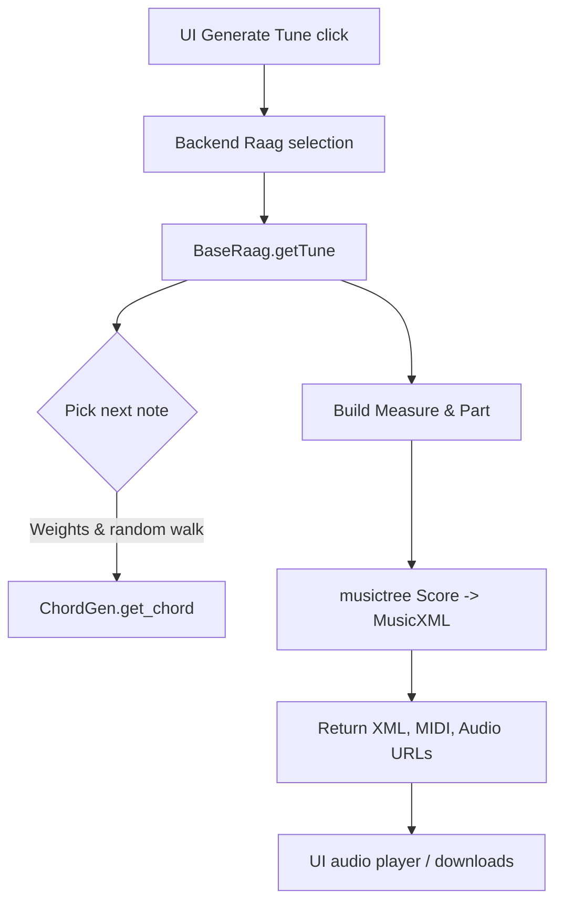

# Music Generation Overview

This document explains how RaagMusicGen constructs a tune from the moment a user presses **Generate Tune** in the UI through to the MusicXML/MIDI/WAV artefacts that are returned.

- **Logic focus** – how the Hindustani raag framework is encoded in code (`BaseRaag`, raag subclasses, random note walks).
- **Tech focus** – helper modules, libraries, and data conversions that bridge between Indian notation, Western MIDI numbers, MusicXML, and final audio.

---

## High-Level Flow

---

## Logic: Raag Framework

### BaseRaag core responsibilities (`Raag/BaseRaag.py`)
1. **Note mapping** – Convert Hindustani `raag_notes` into Western equivalents using `ChordGen.get_western_notes` with the selected base scale (default: C).
2. **Weighted random walk** – Build a list of candidate notes across octaves (mandra/madhya/taar). Each note receives a weight influenced by:
   - Whether it is the raag’s **vaadi** (×5) or **samvaadi** (×3).
   - Whether it sits in the central **madhya** octave (×2).
3. **Melodic path** – Walk through the weighted note grid using constrained steps (`current ±1` or re-sample by weight) to ensure melodic continuity while retaining randomness.
4. **Rhythmic grouping** – Partition notes into beats using probabilities for 1, 2, 4, or 8 notes per beat, producing quarter, eighth, and sixteenth note durations (`duration = 1 / len(beat_notes)`).
5. **Chord creation** – Call `get_note`/`ChordGen.get_chord` to translate each Hindi note into a `Chord` with lyrics (Sargam syllables) that musictree can serialise.
6. **Score assembly** – Use musictree’s `Score` and `Part` objects to build measures, attach instrument metadata, and finally serialise to MusicXML (`score.get_xml_string()`).

### Raag subclasses
Each raag class (e.g., `Raag/Yaman.py`) feeds BaseRaag:
- `name`
- `vadi` / `samvadi`
- `raag_notes` (ordered Hindustani scale degrees used by the raag)

To add a new raag, implement a class deriving from `BaseRaag` with the appropriate Swaras and pass it to the backend selection logic.

### Lyric attachment
For every generated note, `note.add_lyric(hindi_note)` writes the Sargam syllable directly into the MusicXML so rendered scores show Hindi lyrics beneath the staff.

---

## Tech: Libraries & Conversions

### ChordGen helpers (`MusicNotes/ChordGen.py`)
- Maintains the Sargam-to-Western lookup and absolute MIDI numbers.
- `get_chord(note, octave, duration)` returns a musictree `Chord` using MIDI numbers for pitch.
- `get_rest(duration)` builds silence segments when needed.
- `get_western_notes(indian_notes, scale)` handles base-scale transposition.

#### Note reference
| Hindi (Sargam) | Western (scale C) | MIDI (Octave 3) |
| -------------- | ----------------- | --------------- |
| सा             | C                 | 60              |
| रे             | D                 | 62              |
| ग             | E                 | 64              |
| म’            | F#                | 78 (octave shift)|
| प             | G                 | 67              |
| ध             | A                 | 69              |
| नि            | B                 | 71              |

> The full mapping is in `ChordGen.sargam_swar` and `ChordGen.western_notes`. `ChordGen.notes` provides exact MIDI numbers for C0–G#8.

### Instrument metadata (`MusicNotes/Instrument.py`)
| ID | Name    | MuseScore Sound ID           |
| -- | ------- | ---------------------------- |
| 0  | Guitar  | `pluck.guitar.acoustic`      |
| 1  | Flute   | `wind.flutes.flute`          |
| 2  | Sitar   | `pluck.sitar`                |
| 3  | Piano   | `keyboard.piano.grand`       |
| 4  | Harmonium | `keyboard.harmonium`      |
| 5  | Violin  | `strings.violin`             |

### musictree & musicxml
- **musictree** builds the in-memory score. Key objects:
  - `Score`, `Part`, `Measure`, `Chord`.
- **musicxml** (deps under `musicxml/`) serialises the musictree object graph to valid MusicXML; the backend returns the XML string to the UI.
- The UI converts MusicXML to audio via `webmscore` (WASM build of MuseScore) and exposes MIDI/WAV downloads.

### Audio conversion utilities
- `ui_src/src/utils/audio.ts` converts Web Audio `AudioBuffer` objects into WAV blobs for download.
- `ui_src/src/utils/download.ts` handles blob/URL downloads without external libraries.

---

## Generate Tune Call Stack
1. **UI**: `App.tsx` calls the `/GenerateTune/Raag/{raag}/Instrument/{instrument}` endpoint.
2. **Backend**: Endpoint selects the appropriate `BaseRaag` subclass and invokes `getTune`.
3. **BaseRaag.getTune**: Generates melodic content and returns `(xml_string, debug_notes, weights)`.
4. **Response**: Backend packages the XML along with MIDI/audio URLs; UI renders SVG via `webmscore` and streams audio through the HTML `<audio>` element.

---

## Extension Guide

### Adding a new raag
1. Create `Raag/<NewRaag>.py` inheriting from `BaseRaag` with `vaadi`, `samvaadi`, and `raag_notes`.
2. Update any raag registry (backend selection logic) to expose the new class.
3. Add UI dropdown entry so users can pick the raag.
4. Update documentation tables as needed.

### Adding a new instrument
1. Append the instrument to `MusicNotes/Instrument.py` with a unique ID and MuseScore sound ID.
2. Ensure UI enumerations include the new instrument.
3. Verify the MuseScore soundfont bundle contains the requested sound ID.

### Supporting other formats
- **MusicXML variations**: musictree already outputs compliant XML; for additional metadata (time signatures, key signatures), extend the musictree score before serialisation.
- **MIDI routing**: `BaseRaag` already produces MIDI via `score.saveMidi()`; adjust instrument program numbers there if instrument mapping changes.
- **Audio engine**: The UI relies on `webmscore` + AudioContext. Swapping the renderer (e.g., Web MIDI or custom synth) involves changing `ui_src/src/App.tsx` to handle different output strategies.

---

## Validation Checklist
- [ ] Re-run a full tune generation (UI or backend test harness) to confirm notes, lyrics, and instruments match documentation.
- [ ] Confirm documentation links remain accurate after refactors.
- [ ] Keep tables and diagrams updated when new raags/instruments are added.
